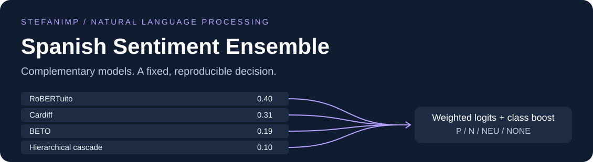

# Spanish Sentiment Ensemble

[](https://github.com/stefanimp/spanish-sentiment-ensemble/actions/workflows/ci.yml)

Spanish sentiment classification with **RoBERTuito, Cardiff, BETO and a hierarchical cascade**.
The ensemble predicts positive (`P`), negative (`N`), neutral (`NEU`) or no opinion (`NONE`).

**1st place in the University of Jaén NLP tournament**, confirmed by the author.
Reported **public macro F1: 0.64182**. Individual project by [stefanimp](https://github.com/stefanimp).
[Technical report](docs/report.pdf) · [Design and result provenance](docs/design.md)

## Why an ensemble

Short social posts often make neutral sentiment and absence of opinion hard to separate.
The cascade learns those boundaries explicitly, while the other models contribute different
sentiment representations. A fixed weighted blend combines their logits before applying
a small class adjustment.

The repository supports two paths: lightweight CPU replay of archived logits, and optional
training of the four components. Replay itself does not classify arbitrary new text.

## Quick start

Requires Python **3.12 or 3.13** and [uv](https://docs.astral.sh/uv/getting-started/installation/).

```bash
git clone https://github.com/stefanimp/spanish-sentiment-ensemble.git
cd spanish-sentiment-ensemble
uv sync --python 3.12 --locked --extra dev
uv run spanish-sentiment demo
uv run pytest -q
```

The demo is synthetic and uses no pretrained model or dataset. CPU replay depends only on
NumPy; PyTorch is loaded only when training. Installation downloads dependencies.
[Standard pip installation](docs/reproduction.md#installation).

## Replay archived predictions

Use the original four logit matrices and test IDs in their original row order.
These artifacts are excluded from Git; see [the input layout](docs/reproduction.md#inputs).

```bash
uv run spanish-sentiment check --logits-dir assets/private --test-csv assets/private/pln-uja-practica-final/test.csv
uv run spanish-sentiment replay --logits-dir assets/private --test-csv assets/private/pln-uja-practica-final/test.csv --output artifacts/submission.csv --reference assets/private/pln-uja-practica-final/submission_v22_02_cascade010.csv
```

The maintained implementation reproduces **all 1,706 labels** in the archived `v22_02` CSV.
It checks matrix shape, finite values and test IDs, compares an optional reference before
writing, and refuses to overwrite outputs. [Verification record](docs/verification.json).

## Train a component

Inspect a recipe without downloading models or starting training:

```bash
uv run spanish-sentiment train --component cascade --train-csv assets/private/pln-uja-practica-final/train.csv --test-csv assets/private/pln-uja-practica-final/test.csv --output-dir artifacts/training-001 --dry-run
```

For actual training, install the optional backend with `uv sync --locked --extra train`,
then remove `--dry-run`. Components are `rob42`, `cardiff`, `beto` and `cascade`.
Use a compatible PyTorch installation for your hardware. [Training details](docs/reproduction.md#training).

## Ensemble

```text
logits = 0.40 * RoBERTuito + 0.31 * Cardiff + 0.19 * BETO + 0.10 * Cascade
scores = normalize(softmax(logits) * [0.97, 1.00, 1.08, 1.08])
prediction = argmax(scores)                       # P, N, NEU, NONE
```

## Results and limits

The author confirms first place and **0.64182 as a public score**; no private score has been
supplied. The archived report contains other experimental figures. They are not substituted
for this confirmed result, and replay parity does not establish which submission won.
The original data also contains duplicate and overlapping records; these are preserved for
regression comparison and discussed in the design notes.

[Design and tradeoffs](docs/design.md) · [Run and reproduce](docs/reproduction.md) ·
[Contribute](CONTRIBUTING.md) · [MIT license](LICENSE)
